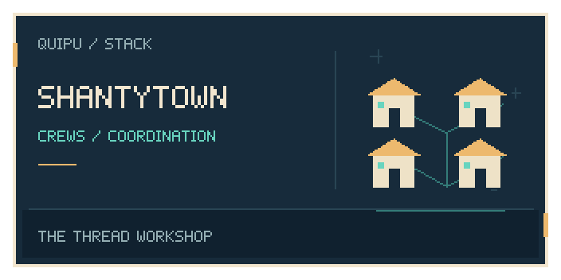

<p align="center"></p>

<p align="center"></p>
<h1 align="center">shantytown</h1>
<p align="center"><em>🏭 Ship software and organize everyday work with a crew of AI agents.</em></p>
<p align="center">
<a href="LICENSE"></a>
<a href="https://github.com/scbrown/shantytown/actions/workflows/ci.yml"></a>
<a href="https://github.com/scbrown/caboodle"></a>
</p>

**A crew of AI agents for shipping software and running everyday operations:
part of the Quipu stack.** Use it to coordinate a software factory where agents and CI plan, build,
check and deliver changes, or for personal operations such as research and
follow-up work. You supply the goals, tools and access; the same work items,
ownership and controls organize both. Quipu integration is optional.

## Why you would want it

- **Keep ownership visible:** give each agent a role and ranked work.
- **Review a crew before launching it:** preview cards, hooks and approval settings.
- **Resume durable work:** retain the queue and coordination state between sessions.

[The Shantytown book](https://intigraph.github.io/shantytown/) explains crew setup and operation.

## Install

```sh
curl -fsSL https://raw.githubusercontent.com/scbrown/shantytown/main/install.sh | sh
```

Python 3.11+ with venv/pip, curl, and a Linux or macOS shell. Downloads the latest checksummed wheel into its own virtual environment;
command links go in `~/.local/bin`. Add that directory to `PATH`.

Set `STACK_INSTALL_ROOT` on the receiving shell for another prefix.
Pinned releases, alternatives, configuration and removal are in the
[installation and usage reference](docs/installation-reference.md).

## First success in three commands



Both commands are non-writing previews; no crew is launched.
[Read the transcript](docs/demos/terminal/transcript.txt) or
[reproduce the recording](docs/demos/terminal.md).

Preview a two-agent crew in an empty directory. This writes nothing and launches no session:

```sh
mkdir shantytown-demo && cd shantytown-demo
st --root .shanty --backend files fleet init -y --admin coordinator --crew builder --dry-run
```

Expected preview:

```text
  store    .shanty
  dir      crew/
  dir      settings/
  dir      events/
  dir      launched/
  card     coordinator  administrator  pane st-coordinator
  card     builder      worker         pane st-builder
  hooks    settings/administrator.settings.json
  hooks    settings/worker.settings.json
  permissions for NEW cards: MANUAL (approval prompts enabled)
  config   .shanty/shantytown.toml

  2 agent(s) · startup mode 'lite' · hibernate off

  --dry-run: nothing written.
```

To preview just one administrator, use an empty worker list:

```sh
st --root .shanty --backend files fleet init -y --admin coordinator --crew "" --dry-run
```

The preview shows the crew, hooks and approval mode before you commit to running it.
Follow [Getting started](https://scbrown.github.io/shantytown/getting-started.html) to create and launch the crew.

## On your own code

| You want to | Entry point |
|---|---|
| Plan a crew for a project | The `fleet init --dry-run` example above |
| Choose repository and tracker adapters | [Adapter guide](docs/adapters.md) |
| Inspect available commands | `st --help` |

[CLI reference](https://intigraph.github.io/shantytown/cli.html) covers lifecycle and work commands.

## Wire it into your agent


Run `st prime` for the tool primer and a bounded crew/anchor summary, or
`st prime --static` offline. [Prime contract and generated primer](docs/prime.md)
and the [Shantytown skill](skills/shantytown/SKILL.md) share the runtime source.
`st anchor` remains the normal session startup command.


Choose roles, tools and approval settings before launching agents. The dry run
creates no sessions; follow the [setup guide](https://intigraph.github.io/shantytown/getting-started.html)
for an actual crew.

## Before you start

Python 3.11+, venv/pip, curl and Linux or macOS are required by the installer.
A running crew also needs the chosen agent harness, tracker and repository access.
Quipu integration is optional. Installation does not grant agents credentials
or change their approval settings.

## What's next

- [The Shantytown book](https://intigraph.github.io/shantytown/): crew concepts and operation.
- [Getting started](https://intigraph.github.io/shantytown/getting-started.html): create your first crew.
- [CLI reference](https://intigraph.github.io/shantytown/cli.html): lifecycle and work commands.

### Related tools and repository knowledge

- [Tambo](https://github.com/scbrown/tambo): guided stack installation and verification.
- [Camayoc](https://github.com/scbrown/camayoc): governed memory and vocabulary.
- [Detailed examples and agent setup](docs/installation-reference.md).
- [full CLI reference](https://scbrown.github.io/shantytown/cli.html).

**Load this repository’s graph:** public repository-pendant assets have not yet been verified. When a release supplies the archive, checksum and provenance, follow the [verified import workflow](https://scbrown.github.io/quipu/sharing/index.html): extract the share directory and use `quipu import SHARE_DIR --db repository.db`. Import stages knowledge; ROOT stays unchanged.

## 🧺 The stack

<!-- stack-table:start -->

The Quipu stack is built around a governed, bitemporal knowledge store: shared
facts, decisions and work history your agents can query. Quipu can check writes
against your rules, records where each fact came from, and answers what was true
when.

| tool | what it gives your agents |
|---|---|
| [tambo](https://github.com/intigraph/tambo) | 🧰 Agent Platform Toolkit - installs and configures the quipu stack |
| [quipu](https://github.com/scbrown/quipu) | stores shared facts with provenance and history; can check writes against your rules |
| [camayoc](https://github.com/scbrown/camayoc) | prepares knowledge and vocabulary for Quipu, with checks before it is admitted |
| [quechua](https://github.com/scbrown/quechua) | shared vocabulary and shapes for interoperable knowledge |
| [chaski](https://github.com/scbrown/chaski) | reacts to graph changes and delivers governed notifications |
| [bobbin](https://github.com/scbrown/bobbin) | indexes your codebase and injects context from that index and Quipu knowledge |
| [yupana](https://github.com/scbrown/yupana) | shows code impact and can read policies from Quipu to govern agent actions |
| [desire-path](https://github.com/scbrown/desire-path) | turns agent mistakes into feature requests; works on its own without Quipu |
| [seeds](https://github.com/scbrown/seeds) | a work item tracker backed by the Quipu knowledge base |
| [shantytown](https://github.com/scbrown/shantytown) | runs crews of AI agents on work items, triggered by hand, on a schedule or by events; can share work and memory through Quipu |
| [rikuy](https://github.com/scbrown/rikuy) | live brief: status, graphs, watches and signed decisions over Quipu |
| [shuttle](https://github.com/scbrown/shuttle) | runs signed agent workflows and keeps their records in Quipu |

<!-- stack-table:end -->

## Contributing

```sh
python3 -m pytest -q
```

Read [CONTRIBUTING.md](CONTRIBUTING.md) for conventions and validation.

## 📜 License

[Apache-2.0](LICENSE)
