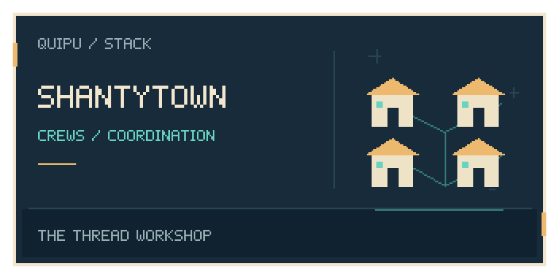

<p align="center"></p>

<h1 align="center">shantytown</h1>
<p align="center"><em>🏭 Ship software and organize everyday work with a crew of AI agents.</em></p>
<p align="center">
<a href="LICENSE"></a>
<a href="https://github.com/intigraph/shantytown/actions/workflows/ci.yml"></a>
<a href="https://github.com/intigraph/tambo"></a>
</p>

**Shantytown runs a crew of AI coding agents from one command line, `st`.** It is
for people who already run agents such as Claude Code or Codex in terminals and
want them to share a queue of work. Each work item has one owner, workers
report up a chain of leads, and the crew stays inside the usage limits you set. It is a
Python CLI with no resident service; the agents run in tmux. The same crew can
take on everyday work such as research and follow-ups. It is part of the Quipu
stack and also runs without it.

<p align="center"></p>

## Why you would want it

- **Hand work to an agent without typing over it.** `st go` assigns a work item
  to a named agent, reads what that agent's terminal is doing and refuses
  instead of interrupting a busy session. Each command exits 0 (done),
  1 (refused) or 2 (could not tell), so a script never takes a guess for success.
- **Run a crew with a chain of responsibility.** Workers report to leads and
  leads to an administrator. When an agent stops, the event goes up that chain.
  One crew can mix Claude Code, Codex and OpenCode, and can start a short-lived
  supervised agent for one job, such as reviewing a pull request.
- **Leave it running inside limits you set.** A governor can read each
  provider's usage windows and hold new launches when one is spent. Session
  ceilings cap hours and items, an idle agent can be given the next ranked item,
  and stalled work is nudged before it is escalated.

The full case and the comparison with the alternatives are in
[Why Shantytown?](https://intigraph.github.io/shantytown/why.html). The current
capabilities are in [Features](https://intigraph.github.io/shantytown/features.html).

## Install

```sh
curl -fsSL https://raw.githubusercontent.com/intigraph/shantytown/main/install.sh | sh
```

The installer needs Python 3.11+ with venv and pip, curl, and a Linux or macOS
shell. It downloads the latest checksummed wheel into its own virtual
environment and links `st` into `~/.local/bin`. Add that directory to `PATH`,
or set `STACK_INSTALL_ROOT` for another prefix.

Check it:

```sh
st --version
```

This prints `st` and the installed release, for example `st 0.22.0`. Pinned
releases, pipx, a source install and removal are in the
[installation reference](docs/installation-reference.md).

## First success in three commands



Preview a two-agent crew in an empty directory. The preview writes nothing and
starts no agent:

```sh
mkdir shantytown-demo && cd shantytown-demo
st --root .shanty --backend files fleet init -y --admin coordinator --crew builder --dry-run
```

Expected preview:

```text
  store    .shanty
  dir      crew/
  dir      settings/
  dir      events/
  dir      launched/
  card     coordinator  administrator  pane st-coordinator
  card     builder      worker         pane st-builder
  hooks    settings/administrator.settings.json
  hooks    settings/worker.settings.json
  permissions for NEW cards: MANUAL (approval prompts enabled)
  config   .shanty/shantytown.toml

  2 agent(s) · startup mode 'lite' · hibernate off

  --dry-run: nothing written.
```

The preview lists the agent cards, the hooks and the approval mode before
anything is written. Run the same command without `--dry-run` to create the
crew, then `st fleet start` to launch it.
[Getting started](https://intigraph.github.io/shantytown/getting-started.html)
covers the first real crew. The recording has a
[transcript](docs/demos/terminal/transcript.txt) and a
[recipe to reproduce it](docs/demos/terminal.md).

## On your own code

With a crew created, use the ID your tracker returns in place of `st-1`:

| you want to | run |
|---|---|
| Create a work item | `st task "fix the login timeout"` |
| Give it to an agent | `st go st-1 builder` |
| See who is free, busy or down | `st crew` |
| Run one crew on two machines | [A crew across hosts](https://intigraph.github.io/shantytown/multi-host.html) |
| See what one agent has on its plate | `st anchor builder` |
| Open an agent's terminal | `st attach builder` |
| Start a supervised agent for one pull-request review | `st agent spawn --ephemeral --job review --item st-1 --repo OWNER/NAME --pr 12` |
| Check the installation | `st ops doctor` |

Add `--dry-run` to a writing command to see what it would do. A one-job agent
has its own limits and prerequisites; see
[Ephemeral agents](https://intigraph.github.io/shantytown/ephemeral-agents.html).
Every command and exit code is in the
[full CLI reference](https://intigraph.github.io/shantytown/cli.html).

## Wire it into your agent

`st fleet init` writes each agent's card and the hooks for its role, so a new
session starts by running `st anchor`: who the agent is, what is on its plate
and who it reports to. An agent that needs the commands themselves runs:

```sh
st prime
```

`st prime` prints a primer for the `st` tool and a bounded summary of the crew;
`st prime --static` prints the primer alone, offline. The same text ships as the
[Shantytown skill](skills/shantytown/SKILL.md); see the
[prime contract](docs/prime.md). To choose which agent program each role runs,
see [Harnesses](https://intigraph.github.io/shantytown/harnesses.html). To
connect Quipu, Seeds, Bobbin or Yupana, see
[Integrations](https://intigraph.github.io/shantytown/integrations.html).

## Before you start

- **Platform:** Linux or macOS, Python 3.11+ and `tmux`.
- **An agent program:** at least one installed and signed in. Claude Code is the
  default; Codex and OpenCode are supported, and Antigravity is experimental.
- **A tracker:** the built-in files tracker needs nothing. beads, `br`, Seeds
  and Forgejo issues are the other choices; see
  [Adapters](https://intigraph.github.io/shantytown/adapters.html).
- **Quipu is optional.** Scheduled routines are the exception: a routine is
  declared in Quipu for Chaski to fire, and that path is still being completed.
  [Scheduled jobs](https://intigraph.github.io/shantytown/jobs.html) has its
  current state.

Installing Shantytown gives agents no credentials and changes no approval
settings. Review both before you leave a crew unattended.

## What's next

- [The Shantytown book](https://intigraph.github.io/shantytown/): concepts and operation.
- [Documentation map](https://intigraph.github.io/shantytown/map.html): every document, by task.
- [Getting started](https://intigraph.github.io/shantytown/getting-started.html): create and launch your first crew.

**Load this repository's graph:** each release publishes a repository pendant
archive with its checksum and provenance. To query it, follow Quipu's
[verified import workflow](https://intigraph.github.io/quipu/sharing/index.html):
extract the share directory and run `quipu import SHARE_DIR --db repository.db`.
An import stages the knowledge and leaves your existing graph unchanged.

## 🧺 The stack

<!-- stack-table:start -->

The Quipu stack is built around a governed, bitemporal knowledge store: shared
facts, decisions and work history your agents can query. Quipu can check writes
against your rules, records where each fact came from, and answers what was true
when.

| tool | what it gives your agents |
|---|---|
| [tambo](https://github.com/intigraph/tambo) | 🧰 Agent Platform Toolkit - installs and configures the quipu stack |
| [quipu](https://github.com/intigraph/quipu) | stores shared facts with provenance and history; can check writes against your rules |
| [camayoc](https://github.com/intigraph/camayoc) | prepares knowledge and vocabulary for Quipu, with checks before it is admitted |
| [quechua](https://github.com/intigraph/quechua) | shared vocabulary and shapes for interoperable knowledge |
| [chaski](https://github.com/intigraph/chaski) | reacts to graph changes and delivers governed notifications |
| [bobbin](https://github.com/intigraph/bobbin) | indexes your codebase and injects context from that index and Quipu knowledge |
| [yupana](https://github.com/intigraph/yupana) | shows code impact and can read policies from Quipu to govern agent actions |
| [desire-path](https://github.com/intigraph/desire-path) | turns agent mistakes into feature requests; works on its own without Quipu |
| [seeds](https://github.com/intigraph/seeds) | a work item tracker backed by the Quipu knowledge base |
| [shantytown](https://github.com/intigraph/shantytown) | runs crews of AI agents on work items, triggered by hand, on a schedule or by events; can share work and memory through Quipu |
| [rikuy](https://github.com/intigraph/rikuy) | live brief: status, graphs, watches and signed decisions over Quipu |
| [shuttle](https://github.com/intigraph/shuttle) | runs signed agent workflows and keeps their records in Quipu |

<!-- stack-table:end -->

## Contributing

```sh
python3 -m pytest -q
```

Read [CONTRIBUTING.md](CONTRIBUTING.md) for conventions and validation.

## 📜 License

[Apache-2.0](LICENSE)
