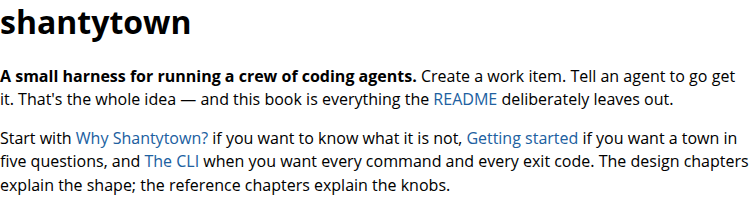
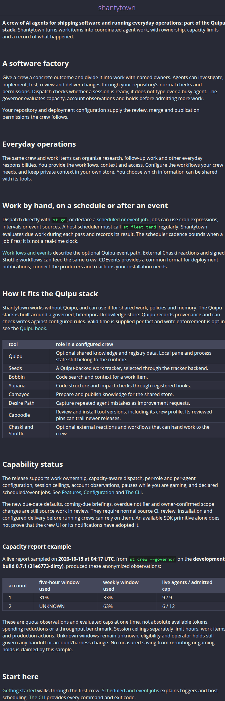

# A crew for software and everyday operations

These are still screenshots, not a video recording. The before image is the
public book introduction captured on 2026-10-15. Its served build SHA was not
measured; the same introductory text is present at source base
`31e677317458f02380e11a8aa1c5d7005c9e634a`.

The after image is the candidate introduction built with mdBook and viewed in
Chrome: software factory, everyday operations, scheduled/event work and the
Quipu stack. Capability status separates released behavior from work in review.
The anonymized governor sample retains its date, units and UNKNOWN window.




Reproduce the candidate from the repository root:

```sh
mdbook build
```

Open `book/index.html` in a browser. Candidate `docs/introduction.md` SHA256:
`383f89dd1dcc54e0a87b9e85e0421515d2e0b3fa1eba3d1b9d86509f45f797ac`. The preview was inspected at desktop and mobile widths with no
page-wide horizontal overflow. This proves a source-built render, not that the
candidate has already reached the published Pages site. The book's stylesheet
is a byte-identical copy of the shared stack stylesheet.
